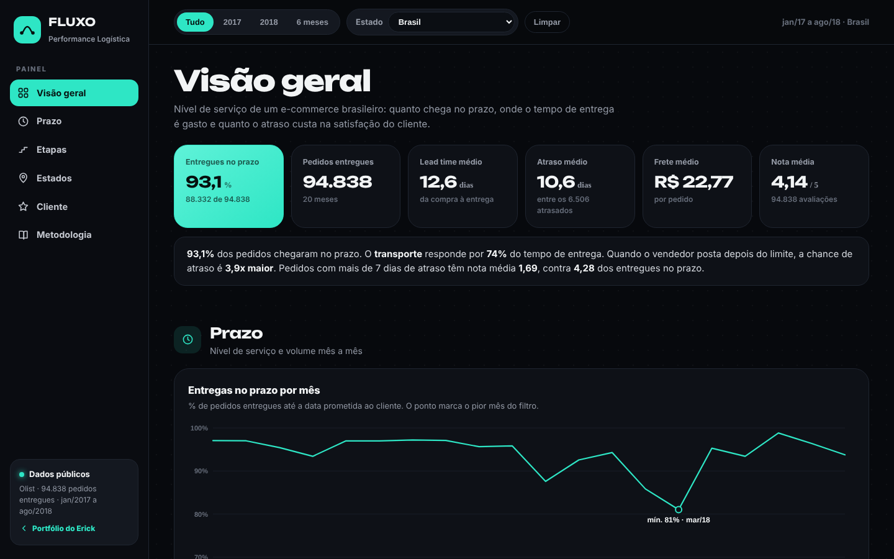
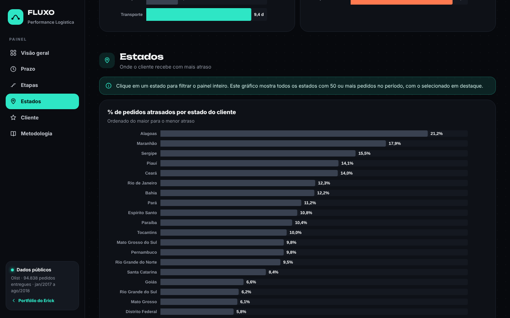

# FLUXO · Performance Logística

**Site:** https://erickkamorim.github.io/performance-logistica/

Dashboard de performance logística com **cerca de 95 mil pedidos reais** de um e-commerce brasileiro (Olist, jan/2017 a ago/2018). Mostra quanto chega no prazo, onde o tempo de entrega é gasto, quais estados recebem pior e quanto o atraso custa na avaliação do cliente.



## Principais resultados

| Indicador | Resultado |
|---|---|
| Entregas no prazo | **93,1%** |
| Lead time médio | **12,6 dias** (74% dele é transporte) |
| Atraso quando o vendedor posta fora do limite | **21,1%**, contra 5,4% dentro do limite (3,9x) |
| Nota média: no prazo vs. 7+ dias de atraso | **4,28 → 1,69** |
| Pior mês | **mar/2018**, com 81% no prazo |

## O que dá para fazer no painel

- Filtrar por período (tudo, 2017, 2018, últimos 6 meses) e por estado
- Clicar em um estado no gráfico para filtrar o painel inteiro
- Passar o mouse nos gráficos para ver o detalhe de cada mês, etapa ou estado
- Abrir a tabela mensal e baixar a base tratada em CSV (pronta para Power BI)



## Como foi feito

1. **SQL (SQLite):** view `vw_entregas` com pedidos entregues, duração de cada etapa e marcação de entrega no prazo.
2. **Python (pandas):** base tratada e agregação por mês × estado × faixa de atraso × postagem do vendedor (`preparacao/preparar_dados.py`).
3. **Painel web:** HTML, CSS e JavaScript puro com gráficos em SVG, sem bibliotecas, publicado no GitHub Pages.

**Regras:** "no prazo" = entrega até a data estimada informada na compra. Etapas: aprovação (compra → pagamento), postagem (aprovação → transportadora) e transporte (transportadora → cliente). Registros com datas inconsistentes foram descartados.

## Estrutura

```
index.html                     painel (dados agregados embutidos)
dados/base_entregas_olist.csv  base tratada, um pedido por linha
preparacao/preparar_dados.py   script que gera a base e o agregado
img/                           prints usados neste README
```

## Fonte dos dados

[Brazilian E-Commerce Public Dataset by Olist](https://www.kaggle.com/datasets/olistbr/brazilian-ecommerce), Kaggle, licença CC BY-NC-SA 4.0.

Veja também a análise em SQL dos mesmos dados: [LUPA](https://erickkamorim.github.io/analise-pedidos-sql/)

---

**Erick Amorim** · [Portfólio](https://erickkamorim.github.io/) · [LinkedIn](https://www.linkedin.com/in/erickkamorim)
